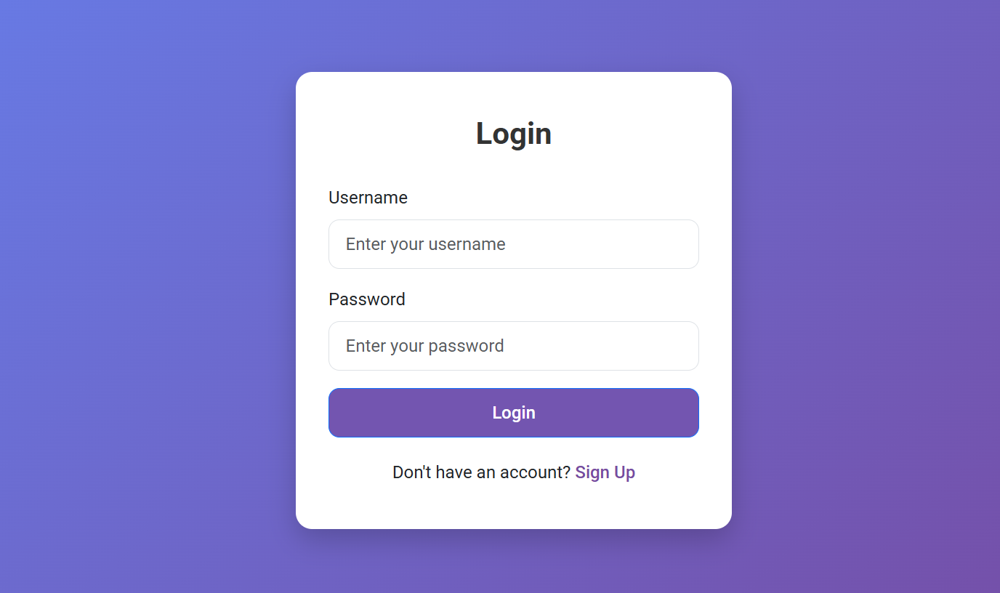
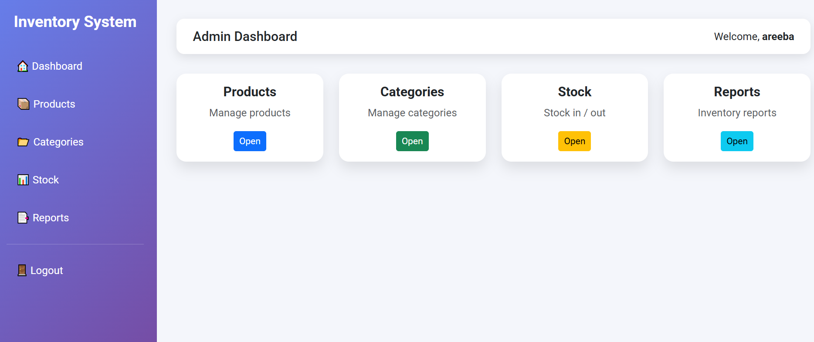

<div align="center">

# 📦 Web-Based Inventory Management System

### A Java MVC web application for smart, secure and real-time inventory control


</div>

---

## 👤 About the Author

| | |
|---|---|
| **Name** | Aryan Mittal |
| **Admission Number** | 25SCSE1410263 |
| **Project** | Java Project |
| **University** | Galgotias University |

---

## 📸 Screenshots

### 🔐 Login Page
<p align="center">
  
</p>

### 🖥️ Admin Dashboard
<p align="center">
  
</p>

---

## 📌 Project Overview

The **Web-Based Inventory Management System** helps organizations manage products and stock levels efficiently.
Manual and spreadsheet-based inventory systems are error-prone, insecure and hard to maintain. This project
replaces them with a web application built on **Java MVC architecture**, which automates inventory operations
and keeps data accurate, secure and up to date.

---

## ❓ Problem Statement

Manual and spreadsheet-based inventory systems lack:

- ❌ Accuracy
- ❌ Security
- ❌ Real-time stock updates

These limitations often lead to stock mismanagement and operational inefficiencies.

---

## 💡 Proposed Solution

The system automates core inventory operations:

- ✅ Product management
- ✅ Category management
- ✅ Stock tracking

It follows **MVC architecture**, which separates business logic, user interface and data handling.
This improves scalability, maintainability and performance.

---

## 🎯 Objectives

- Develop a web-based inventory management system
- Implement MVC architecture
- Manage products, categories and stock
- Reduce human errors
- Generate inventory reports

---

## ✨ Features

| Module | Description |
|--------|-------------|
| 🔐 **Admin Login** | Secure authentication for administrators |
| 📦 **Products** | Add, view, update and delete products |
| 🗂️ **Categories** | Organize products into categories |
| 📊 **Stock** | Record stock in and stock out |
| 📄 **Reports** | View and generate inventory reports |

---

## 🏗️ System Architecture (MVC)

```
┌──────────────┐      ┌─────────────────┐      ┌──────────────────┐
│     VIEW     │ ───▶ │   CONTROLLER    │ ───▶ │      MODEL       │
│ JSP·HTML·CSS │ ◀─── │  Java Servlets  │ ◀─── │ Beans·DAO·MySQL  │
└──────────────┘      └─────────────────┘      └──────────────────┘
```

| Layer | Technology |
|-------|------------|
| **Model** | Java Beans, DAO (Data Access Object), MySQL database via JDBC |
| **View** | JSP, HTML, CSS |
| **Controller** | Java Servlets |

---

## 🛠️ Tools & Technologies

- **Language:** Java
- **Web:** JSP & Servlets
- **Database:** MySQL
- **Connectivity:** JDBC
- **Server:** Apache Tomcat
- **IDE:** Eclipse IDE

---

## 📂 Project Structure

```
Inventory-Management-system/
├── src/               # Java source: servlets, DAO classes, beans
├── WebContent/        # JSP pages, CSS, static resources, WEB-INF
├── build/             # Compiled output
├── IMage1.png         # Login screenshot
├── Image2.png         # Dashboard screenshot
└── README.md
```

---

## 🚀 How to Run the Project

1. **Clone the repository**
   ```bash
   git clone https://github.com/aryanmittal080-source/Inventory-Management-system-.git
   ```
2. **Import the project** into Eclipse IDE
   `File → Import → Existing Projects into Workspace`
3. **Configure Apache Tomcat** in Eclipse (`Window → Preferences → Server → Runtime Environments`)
4. **Set up the MySQL database** and update the JDBC URL, username and password in the DB connection class
5. **Run the project** on the server
   `Right-click project → Run As → Run on Server`
6. Open the app in your browser (usually `http://localhost:8080/<project-name>/`)

---

## 🔮 Future Enhancements

- Low-stock alerts and notifications
- Multiple user roles (admin, staff)
- Export reports to PDF and Excel
- Charts and analytics on the dashboard

---

<div align="center">

### Made with ❤️ by **Aryan Mittal**
Galgotias University · Admission No. 25SCSE1410263

</div>
